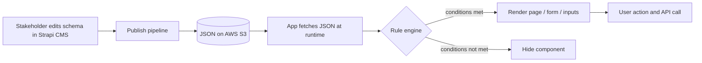

<div align="center">


<a href="https://portfolio-shourya-sengar.vercel.app/">
  
</a>

<br/><br/>

[](https://portfolio-shourya-sengar.vercel.app/)
[](https://linkedin.com/in/shourya-singh-57921b146)
[](mailto:singhshourya2004@gmail.com)
[](https://www.leetcode.com/shourya_singh_sengar)


</div>


I turn messy business workflows into **config-driven, scalable systems**. For 2+ years at **Monocept** I've shipped 3 enterprise apps for **Axis Max Life Insurance** and **Aditya Birla Health Insurance**, serving **100,000+ daily active users** on iOS and Android (part of the team behind a **2024 ET CIO Award for Digital Transformation**).

I started in mobile, but I'm not tied to one stack. I pick the tool that fits the problem, from frontend to backend, cloud and AI-assisted development.

```ts
const shourya = {
  role: "Software Engineer @ Monocept",
  base: "Gurugram, India 🇮🇳",
  mindset: ["stack-agnostic", "systems thinker", "ship small, ship often"],
  strengths: ["Server-Driven UI", "RBAC", "Schema-driven forms", "Auth & token lifecycle"],
  building: ["JobPilot (edge-first, Cloudflare)", "Jira Bug Dashboard"],
  exploring: ["AI-DLC", "Agentic workflows", "Docker", "Serverless on AWS"],
};
```


<div align="center">
  
</div>


<div align="center">


</div>

<details>
<summary><b>More detail</b></summary>
<br/>

**Mobile & Web**       

**Backend & APIs**    

**Cloud & DevOps**      

**Architecture & Practices**       

</details>


<table align="center">
<tr>
<td align="center"><a href="https://jobpilot.shouryacode2021.workers.dev/"></a></td>
<td align="center"><a href="https://jira-bug-dashboard-cloud.shouryacode2021.workers.dev/"></a></td>
</tr>
<tr>
<td align="center"><a href="https://github.com/ShouryaSengar/Portfolio"></a></td>
<td align="center"></td>
</tr>
<tr>
<td align="center"></td>
<td align="center"></td>
</tr>
</table>

<div align="center"><sub>Personal projects link to live demos. mRec, mSpace and ABHI One are client work at Monocept (not public).</sub></div>

<details>
<summary><b>🧩 How my Server-Driven UI pipeline works</b></summary>



No app-store release needed for a workflow change.
</details>


<div align="center">


<br/><br/>

<br/><br/>

<br/><br/>

<picture>
  <source media="(prefers-color-scheme: dark)" srcset="https://raw.githubusercontent.com/ShouryaSengar/ShouryaSengar/output/github-snake-dark.svg" />
  <source media="(prefers-color-scheme: light)" srcset="https://raw.githubusercontent.com/ShouryaSengar/ShouryaSengar/output/github-snake.svg" />
  
</picture>

</div>


**600+ DSA problems solved** with ratings of **1650+ on CodeChef**, **1650+ on LeetCode** and **1250+ on Codeforces**.

[](https://www.leetcode.com/shourya_singh_sengar)
[](https://www.codechef.com/users/shourya_sengar)
[](https://codeforces.com/profile/_annihilator_)


- 🤖 **AI-DLC**: using AI across the whole software lifecycle, not just autocomplete
- 🐳 **Docker** and containerised local-to-cloud workflows
- ☁️ **AWS serverless** and edge hosting on **Cloudflare Workers**
- 🧱 Cleaner backend design: HLD/LLD, trade-offs, failure modes


Ask me about **Server-Driven UI**, **RBAC design**, **React Native at scale**, **GraphQL/Strapi**, or **problem solving**.

<div align="center">

</div>
