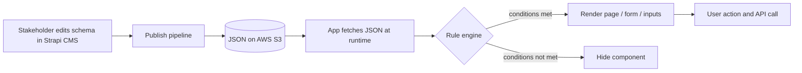

<!-- Header banner -->
<div align="center">


<a href="https://github.com/ShouryaSengar/ShouryaSengar">
  
</a>

<br/>

[](https://portfolio-shourya-sengar.vercel.app/)
[](https://linkedin.com/in/shourya-singh-57921b146)
[](mailto:singhshourya2004@gmail.com)


</div>

---

## 👨‍💻 About

I'm a software engineer who likes turning messy business workflows into **config-driven, scalable systems**. Over the last 2+ years at **Monocept** I've shipped 3 enterprise apps for **Axis Max Life Insurance** and **Aditya Birla Health Insurance**, serving **100,000+ daily active users** on iOS and Android (part of a team recognised with the **2024 ET CIO Award for Digital Transformation**).

Mobile is where I started, but I'm not tied to one stack. I pick the tool that fits the problem, across frontend, backend, cloud and now AI-assisted development.

```ts
const shourya = {
  role: "Software Engineer @ Monocept",
  location: "Gurugram, India 🇮🇳",
  mindset: ["stack-agnostic", "systems thinker", "ship small, ship often"],
  strengths: ["Server-Driven UI", "RBAC", "Schema-driven forms", "Auth & token lifecycle"],
  exploring: ["AI-DLC", "Agentic workflows", "Docker", "Cloud-native on AWS"],
  currentlyReading: "System design, one trade-off at a time",
  funFact: "I'm not funny... but my configs are.",
};
```

---

## 🧰 Tech I Work With

**Mobile & Web**


**Backend & APIs**


**Cloud & DevOps**


**Architecture & Practices**


---

## 🚀 What I've Built

<table>
<tr>
<td width="33%" valign="top">

### 🧩 mRec
**Server-Driven UI recruitment app**

Pages, forms and inputs rendered from JSON on S3, with a rule engine for conditional visibility. Strapi → S3 pipeline lets stakeholders change workflows with no deploy.

`⏱ 20+ dev hrs/week saved`
`🚀 80% faster releases`

</td>
<td width="33%" valign="top">

### 🌐 mSpace
**SuperApp for internal tools**

5 standalone apps merged into one platform using deep linking and modular navigation. Cognito + JWT auth with proactive refresh and 2FA single-device lock. RBAC with event-driven push.

`📈 +40% task completion`
`🔐 -50% unauthorized sessions`

</td>
<td width="33%" valign="top">

### 🏥 ABHI One
**Schema-driven insurance platform**

15+ policy workflows rendered from API metadata. In-app guided assistance with real-time FAQ flows.

`🛠 -70% form dev effort`
`🎧 -35% support tickets`

</td>
</tr>
</table>

### How the Server-Driven UI pipeline works



No app-store release for a workflow change.

---

## 📊 GitHub Stats

<div align="center">


</div>

### 📈 Contribution Activity (public + private)

<div align="center">


</div>

### 🐍 Contribution Snake

<div align="center">

<picture>
  <source media="(prefers-color-scheme: dark)" srcset="https://raw.githubusercontent.com/ShouryaSengar/ShouryaSengar/output/github-snake-dark.svg" />
  <source media="(prefers-color-scheme: light)" srcset="https://raw.githubusercontent.com/ShouryaSengar/ShouryaSengar/output/github-snake.svg" />
  
</picture>

</div>

### 🏆 Trophies

<div align="center">


</div>

---

## 🧠 Problem Solving

Competitive programming keeps my fundamentals sharp: **600+ DSA problems solved**, with ratings of **1650+ on CodeChef**, **1650+ on LeetCode** and **1250+ on Codeforces**.

[](https://www.leetcode.com/shourya_singh_sengar)
[](https://www.codechef.com/users/shourya_sengar)
[](https://codeforces.com/profile/_annihilator_)

---

## 🏅 Highlights

- 🏆 **Achiever of the Month**, Jan 2026, Monocept
- 🥇 **2024 ET CIO Award for Digital Transformation** (team recognition)
- 🎓 B.Tech IT, AKGEC (2020–2024)
- 📚 Deep-dive courses: React Native (28 hrs), React (84 hrs), DSA in C++

---

## 🔭 Currently Exploring

- 🤖 **AI-DLC**: using AI across the whole software lifecycle, not just autocomplete
- 🐳 **Docker** and containerised local-to-cloud workflows
- ☁️ **AWS serverless** and edge hosting on **Cloudflare**
- 🧱 Cleaner backend design: HLD/LLD, trade-offs, failure modes

---

## 🤝 Let's Talk

Ask me about **Server-Driven UI**, **RBAC design**, **React Native at scale**, **GraphQL/Strapi**, or **problem solving**.

<div align="center">


</div>
